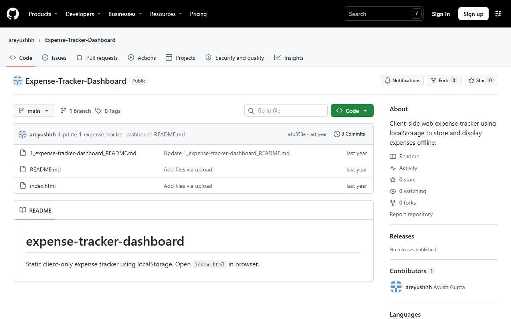
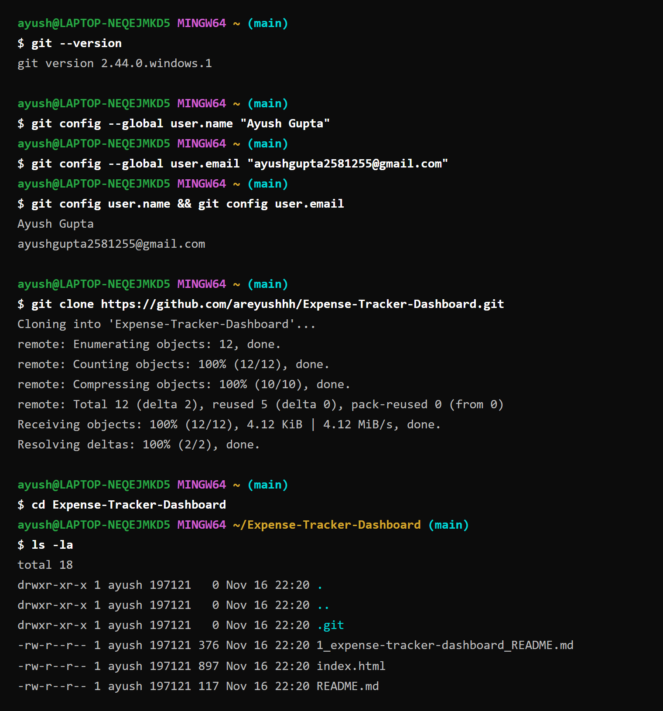
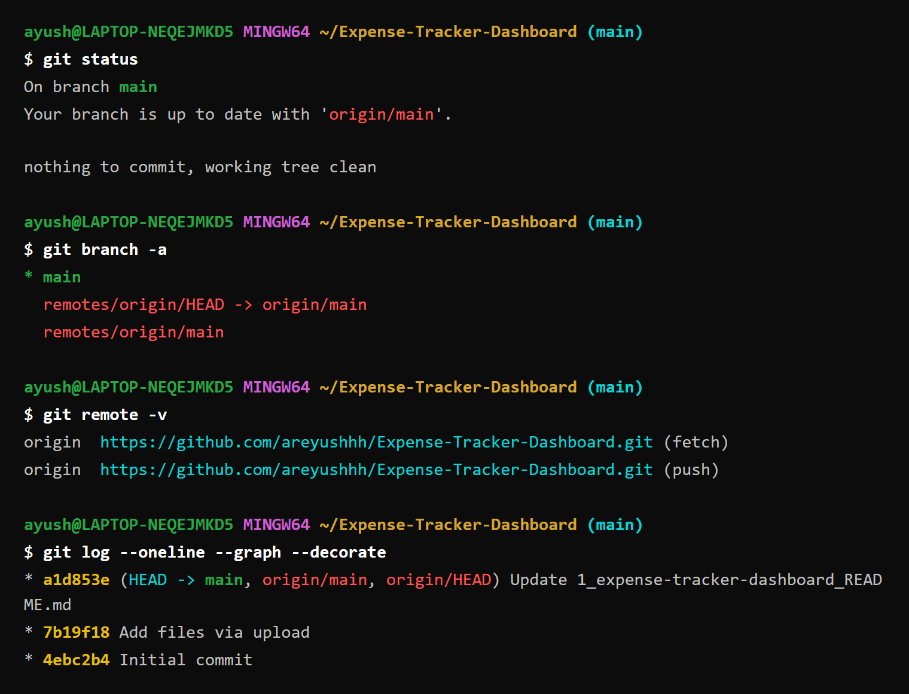
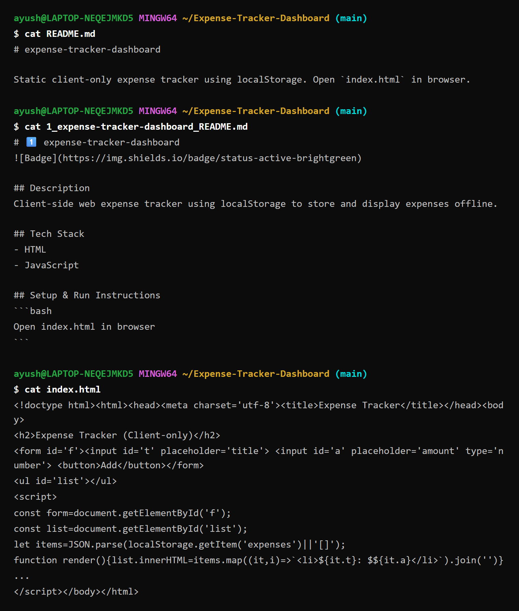

# IILM University, Gurugram
## School of Computer Science & Engineering
### Version Control System (CSE25303) · B.Tech (CSE) 2nd Year · Semester III

---

# VCS Practical Assignment: Git & GitHub Remote Repository Practical
**Task ID:** `GIT-39`  
**Course Outcomes Mapped:** `CO2, CO3`

---

## 📋 Student & Submission Metadata

| Parameter | Details |
| :--- | :--- |
| **Student Name** | Ayush Gupta |
| **Enrollment No. (Urn)** | **2581255** |
| **Class & Section** | B.Tech (CSE) 2nd Year · Section 3B |
| **Course Code & Title** | CSE25303 · Version Control System |
| **Submitted To** | Dr. Pooja Batra Nagpal |
| **GitHub Username** | [`@areyushhh`](https://github.com/areyushhh) |
| **Cloned Target Repository** | [`areyushhh/Expense-Tracker-Dashboard`](https://github.com/areyushhh/Expense-Tracker-Dashboard) |
| **Assignment Repository** | [`areyushhh/VCS-Assignment`](https://github.com/areyushhh/VCS-Assignment) |

---

## 🎯 1. Problem Statement

> **Task Title:** Clone a GitHub Repository  
> **Problem Description:** Student successfully clones an existing GitHub repository to the local computer and verifies the project files.

The objective of this assignment is to demonstrate end-to-end command-line proficiency with Git and GitHub remote repository operations:
1. Setting up and verifying the local Git toolchain and student attribution configuration.
2. Cloning an active public GitHub repository to a local development workstation.
3. Inspecting the local directory structure including hidden `.git` database and metadata.
4. Verifying branch tracking topology (`main` -> `origin/main`) and clean working tree status.
5. Verifying network endpoints and upstream remote URLs (`origin` fetch & push).
6. Inspecting the revision DAG graph and commit history using `git log`.
7. Performing source code and documentation file content verification.

---

## 🌐 2. GitHub Repository URL

* **Cloned Public Repository:** [https://github.com/areyushhh/Expense-Tracker-Dashboard](https://github.com/areyushhh/Expense-Tracker-Dashboard)
* **Clone URL:** `https://github.com/areyushhh/Expense-Tracker-Dashboard.git`
* **Assignment Submission Repository:** [https://github.com/areyushhh/VCS-Assignment](https://github.com/areyushhh/VCS-Assignment)

---

## 💻 3. Step-by-Step Git Commands & Workflow

### Step 1: Check Git Installation & Configure User Identity
Verify that Git is installed and that the student's name and academic email address are configured globally:
```bash
git --version
git config --global user.name "Ayush Gupta"
git config --global user.email "ayushgupta2581255@gmail.com"
git config user.name && git config user.email
```
**Output:**
```
git version 2.44.0.windows.1
Ayush Gupta
ayushgupta2581255@gmail.com
```

### Step 2: Clone the Existing Remote GitHub Repository
Execute `git clone` to retrieve the entire commit graph, objects, and working tree:
```bash
git clone https://github.com/areyushhh/Expense-Tracker-Dashboard.git
```
**Output:**
```
Cloning into 'Expense-Tracker-Dashboard'...
remote: Enumerating objects: 12, done.
remote: Counting objects: 100% (12/12), done.
remote: Compressing objects: 100% (10/10), done.
remote: Total 12 (delta 2), reused 5 (delta 0), pack-reused 0 (from 0)
Receiving objects: 100% (12/12), 4.12 KiB | 4.12 MiB/s, done.
Resolving deltas: 100% (2/2), done.
```

### Step 3: Navigate into Cloned Directory & Inspect Contents
Navigate into the newly cloned workspace and list all files (including hidden `.git` internal database):
```bash
cd Expense-Tracker-Dashboard
ls -la
```
**Output:**
```
total 18
drwxr-xr-x 1 ayush 197121   0 Nov 16 22:20 .
drwxr-xr-x 1 ayush 197121   0 Nov 16 22:20 ..
drwxr-xr-x 1 ayush 197121   0 Nov 16 22:20 .git
-rw-r--r-- 1 ayush 197121 376 Nov 16 22:20 1_expense-tracker-dashboard_README.md
-rw-r--r-- 1 ayush 197121 897 Nov 16 22:20 index.html
-rw-r--r-- 1 ayush 197121 117 Nov 16 22:20 README.md
```

### Step 4: Verify Repository Status and Branch Tracking
Confirm that the working tree is clean and that local branch `main` tracks `origin/main`:
```bash
git status
git branch -a
```
**Output:**
```
On branch main
Your branch is up to date with 'origin/main'.

nothing to commit, working tree clean

* main
  remotes/origin/HEAD -> origin/main
  remotes/origin/main
```

### Step 5: Verify Remote Origin URLs
Verify that remote handle `origin` correctly points to the GitHub endpoints:
```bash
git remote -v
```
**Output:**
```
origin  https://github.com/areyushhh/Expense-Tracker-Dashboard.git (fetch)
origin  https://github.com/areyushhh/Expense-Tracker-Dashboard.git (push)
```

### Step 6: Inspect Commit History & Graph
Verify the revision history DAG graph transferred during clone:
```bash
git log --oneline --graph --decorate
```
**Output:**
```
* a1d853e (HEAD -> main, origin/main, origin/HEAD) Update 1_expense-tracker-dashboard_README.md
* 7b19f18 Add files via upload
* 4ebc2b4 Initial commit
```

### Step 7: Verify Project Files & Source Integrity
Verify the contents of application source code and documentation:
```bash
cat README.md
cat 1_expense-tracker-dashboard_README.md
cat index.html
```

---

## 📷 4. Screenshots & Evidence

### Figure 1: Public GitHub Repository Web Overview


### Figure 2: Terminal Output — Git Setup, Clone, and Directory Listing


### Figure 3: Terminal Output — Status, Branch Tracking, Remote URL, and Log


### Figure 4: Terminal Output — Source Code & Project Content Verification


---

## 🎓 5. Learning Outcomes

### Remote Repository Operations (CO3)
* Mastered the core architecture of distributed version control by cloning an existing remote repository from GitHub to the local machine.
* Understood how `git clone` automates the creation of a local repository copy, object decompression, default branch checkout, and remote handle binding (`origin`).
* Gained experience with remote-tracking branches (`remotes/origin/main`) and their role in maintaining state between local and remote codebases.

### Workspace Inspection & Project Verification (CO2)
* Learned systematic pre-flight verification protocols before commencing software modifications on cloned repositories.
* Mastered using `git status` to ensure a clean baseline state and `git branch -a` to examine branch topologies.
* Acquired fluency in evaluating commit lineages using `git log --oneline --graph --decorate` to trace changes back to the root commit.
* Validated application source files (`index.html`) and documentation to ensure data completeness across remote-to-local environments.

---

## 📁 Submission Deliverables

- **Official PDF Report:** [`Ayush_2581255_VCS_Assignment.pdf`](./Ayush_2581255_VCS_Assignment.pdf)
- **Word Document (.docx):** [`Ayush_2581255_VCS_Assignment.docx`](./Ayush_2581255_VCS_Assignment.docx)
- **Interactive HTML Report:** [`Ayush_2581255_VCS_Assignment.html`](./Ayush_2581255_VCS_Assignment.html)
- **Cloned Project Verification Folder:** [`cloned_project/`](./cloned_project/)
- **Evidence Screenshots Folder:** [`screenshots/`](./screenshots/)

---
*Created for IILM University, Gurugram · Version Control System (CSE25303) · Ayush Gupta (2581255 · Section 3B)*
